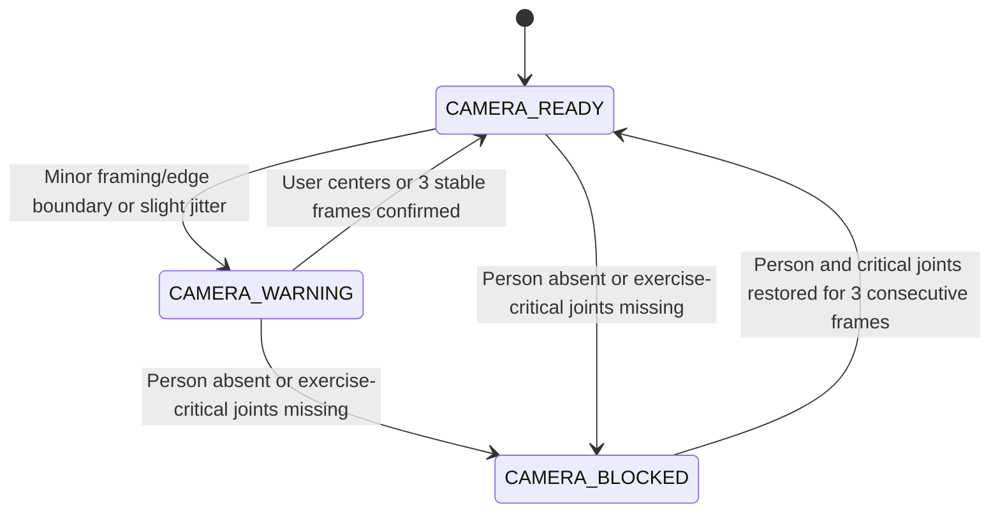
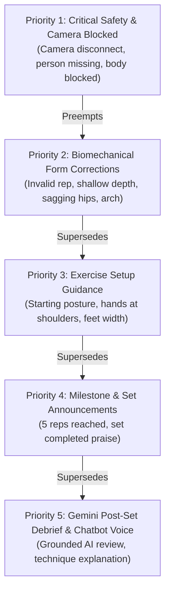
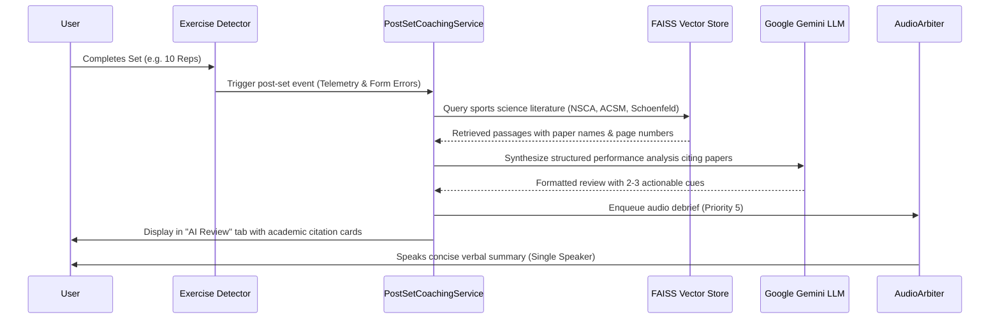
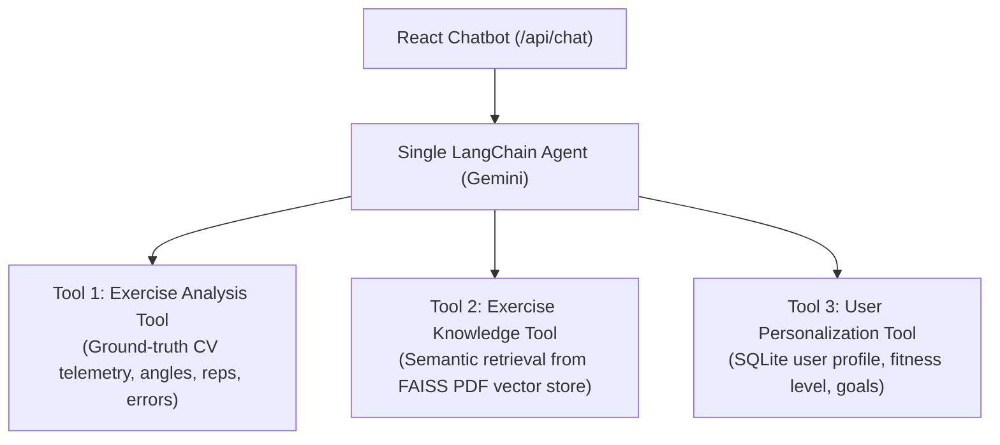

# AI Gym Coach — Research-Based Intelligent Exercise Monitoring & Agentic Coaching System

[](https://www.python.org/)
[](https://fastapi.tiangolo.com/)
[](https://react.dev/)
[](https://developers.google.com/mediapipe)
[](https://www.langchain.com/)
[](https://ai.google.dev/)
[](https://github.com/facebookresearch/faiss)
[](LICENSE)

A production-grade, research-grounded intelligent exercise coaching system that pairs **real-time MediaPipe pose estimation** and **biomechanical joint-angle analysis** with a **3-tier quiet camera reliability gate**, **kinematic movement-phase repetition counters**, a **single-speaker centralized audio arbiter**, and a **single LangChain agent equipped with exactly three tools** powered by **Google Gemini** and a **persistent PDF RAG sports-science vector store**.

---

## 📑 Table of Contents

- [Key Highlights & Architecture](#-key-highlights--architecture)
- [Primary Project Objectives](#-primary-project-objectives)
- [System Architecture](#-system-architecture)
- [3-Tier Camera Reliability Gatekeeper](#-3-tier-camera-reliability-gatekeeper)
- [Centralized Audio Arbiter (5-Priority Voice System)](#-centralized-audio-arbiter-5-priority-voice-system)
- [Supported Exercises & Biomechanical State Machines](#-supported-exercises--biomechanical-state-machines)
- [Exercise-Specific Starting Posture & Activity Guidance](#-exercise-specific-starting-posture--activity-guidance)
- [PDF RAG-Grounded Gemini Post-Set Coaching](#-pdf-rag-grounded-gemini-post-set-coaching)
- [Single LangChain Agent with Exactly 3 Tools](#-single-langchain-agent-with-exactly-3-tools)
- [Ultra-Low Latency Video & Canvas Skeleton Streaming](#-ultra-low-latency-video--canvas-skeleton-streaming)
- [Project Directory Structure](#-project-directory-structure)
- [Installation & Setup](#-installation--setup)
- [Running the Application](#-running-the-application)
- [Automated Test Suite & Verification](#-automated-test-suite--verification)
- [Research Grounding & Citations](#-research-grounding--citations)
- [License](#-license)

---

## 🌟 Key Highlights & Architecture

- **True Real-Time Pose Tracking**: 33 anatomical landmarks tracked at 30+ FPS with sub-millisecond angle trigonometry using vector dot products and 1€ temporal filtering.
- **Quiet & Non-Intrusive Camera Reliability**: Replaces constant camera interruptions with a 3-state system (`CAMERA_READY`, `CAMERA_WARNING`, `CAMERA_BLOCKED`). Small movements never halt exercises; spoken camera warnings are capped at 2 per episode.
- **Single-Speaker Voice Arbitration**: Centralized audio controller ensures strictly $\le 1$ voice message speaks at any time across 5 strict priority tiers. Ordinary camera warnings can never preempt active form corrections or Gemini debriefs.
- **Deterministic Biomechanical Detectors**: Five complete exercise detectors (Squats, Push-ups, Biceps Curls, Shoulder Press, Lunges) that evaluate range-of-motion, tempo, posture, and symmetry before awarding reps.
- **Activity State Manager**: Automatically guides the user into the proper starting posture before beginning, and tracks rest intervals between sets.
- **PDF RAG Post-Set Coaching**: At set completion, the system automatically aggregates authentic joint metrics, searches peer-reviewed sports science literature (NSCA, ACSM, Schoenfeld, Contreras, Saeterbakken), and synthesizes actionable Gemini feedback.
- **Single LangChain Agent with 3 Tools**: Exactly one conversational agent with Tool 1 (Exercise Analysis), Tool 2 (RAG Knowledge), and Tool 3 (User Personalization). No hallucinated video analysis.

---

## 🎯 Primary Project Objectives

### Objective 1: Real-Time Human Pose Estimation and Joint-Angle Analysis
- **Webcam Video Capture**: Captures browser frames at native webcam resolution and streams normalized landmark coordinates over WebSocket.
- **MediaPipe Pose Estimation**: Leverages Google's `pose_landmarker_full.task` model to track 33 3D body keypoints.
- **Zero-Latency Canvas Overlay**: Renders skeleton bones and joint angles on a transparent HTML5 canvas overlay over the native `<video>` stream, bypassing expensive video re-encoding.
- **Biomechanical Trigonometry**: Joint angles are calculated using Euclidean vector dot products:
  $$\cos(\theta) = \frac{\vec{u} \cdot \vec{v}}{\|\vec{u}\| \|\vec{v}\|}, \quad \theta = \arccos\left(\frac{\vec{u} \cdot \vec{v}}{\|\vec{u}\| \|\vec{v}\|}\right)$$

### Objective 2: Exercise Monitoring, Movement Phases, and Repetition Counting
- **Kinematic Phase Tracking**: State machines track cycles (`READY` $\rightarrow$ `LOWERING/ECCENTRIC` $\rightarrow$ `BOTTOM/INFLECTION` $\rightarrow$ `RISING/CONCENTRIC` $\rightarrow$ `COMPLETED`).
- **Strict Repetition Validation**: Repetitions are only incremented if full range-of-motion is achieved without critical biomechanical faults.
- **Predefined Biomechanical Rules**: Form errors (shallow depth, forward lean, hip sag, excessive lumbar arch, elbow drift) trigger instant spoken corrections.
- **Session Persistence**: Sets, reps, calories, and duration are persisted in SQLite (`data.db`).

---

## 🏗️ System Architecture


flowchart TD
    subgraph Frontend ["React 19 + Vite Frontend"]
        Webcam["Native Webcam <video> (0ms Latency)"]
        Overlay["Transparent HTML5 Canvas Skeleton"]
        AudioClient["Frontend AudioArbiter (Audio & Web Speech)"]
        ChatUI["Conversational AI Coach Drawer"]
        Dashboard["Exercise Dashboard & AI Review Tab"]
    end

    subgraph Backend ["FastAPI Python Backend"]
        WS["WebSocket Ingress (/ws/exercise)"]
        MediaPipe["MediaPipe Pose Landmarker"]
        RelGate["3-Tier Camera Reliability Gate"]
        ActState["Activity State Manager & Guidance"]
        Detectors["Exercise Detectors (Squat, Push-up, Curl, Press, Lunge)"]
        AudioBackend["Backend AudioArbiter (5 Priority Tiers)"]
        PostSetService["Post-Set Coaching Service"]
        Agent["Single LangChain Agent (Gemini)"]
        FAISS["FAISS Vector Store (Sports Science PDF RAG)"]
        SQLite[("SQLite Database (data.db)")]
    end

    Webcam -->|Base64 Frame (maxsize=1)| WS
    WS --> MediaPipe
    MediaPipe --> RelGate
    RelGate -->|Trusted Landmarks| Detectors
    RelGate --> ActState
    Detectors -->|Rep Events & Biomechanical Errors| AudioBackend
    Detectors -->|Set Completed| PostSetService
    PostSetService --> FAISS
    PostSetService --> Agent
    Agent --> SQLite
    AudioBackend -->|Serialized Audio & Cues| AudioClient
    WS -->|Normalized 33 Landmarks (~2KB)| Overlay
    PostSetService -->|Structured Review & Citations| Dashboard
```

---

## 🛡️ 3-Tier Camera Reliability Gatekeeper

Earlier pose systems disrupt workouts by shouting camera warnings whenever the user makes small body adjustments. We replaced brittle checks with a robust, exercise-aware **3-tier camera reliability state machine**:



### State Breakdown

| State | Condition | Exercise Detector Status | Audio Feedback Behavior | UI Visual Badge |
|---|---|---|---|---|
| **`CAMERA_READY`** | Person detected, exercise-critical joints visible, good framing, stable tracking. | **Fully Active**: Processing reps, joint angles, and form. | Normal exercise cues and milestone announcements. | 🟢 **Camera Ready** (Green) |
| **`CAMERA_WARNING`** | Minor boundary clipping or slight tracking noise, but **exercise-critical joints are still visible**. | **Remains Active**: User can continue exercising uninterrupted. | **Limited to at most 2 spoken warnings** per episode; visual banner thereafter. Cannot preempt form corrections. | 🟡 **Camera Warning** (Yellow Banner) |
| **`CAMERA_BLOCKED`** | No person detected, or joints required for the selected exercise are missing. | **Paused**: Rep counting halted until joints return to view. | Spoken instruction (Priority 1) directing user how to position camera. | 🔴 **Camera Blocked** (Red Alert) |

### Exercise-Specific Joint Requirements
- **Squats / Lunges**: Requires hips, knees, and ankles. Wrists do not block squats.
- **Shoulder Press**: Requires shoulders, elbows, and wrists overhead. Ankles do not block shoulder press.
- **Biceps Curls**: Requires shoulders, elbows, and wrists. Lower body not required.
- **Push-ups**: Requires shoulders, elbows, hips, and knees.

---

## 🎙️ Centralized Audio Arbiter (5-Priority Voice System)

To eliminate overlapping voices, repeated corrections, and audio chaos, all voice messages pass through a centralized **Audio Arbiter** (`backend/ai_services/audio_arbiter.py` and `frontend/src/services/AudioArbiter.js`).

### Priority Hierarchy



### Core Arbiter Rules:
1. **Single-Speaker Invariant**: At any moment, strictly $\le 1$ voice message can play.
2. **Preemption Protection**: Ordinary camera warnings (`CAMERA_WARNING`) can **never** interrupt an active exercise form correction (P2) or a Gemini set debrief (P5).
3. **Episode-Based Warning Capping**: Within any single continuous camera-warning episode, at most **2 voice warnings** are spoken. Subsequent warnings are purely visual to avoid annoyance.
4. **Consecutive Error Deduplication**: Identical form corrections cannot repeat within an 8.0–12.0s window while the user is actively working.
5. **Post-Speech Silence Gap**: Enforces a strict 5.0-second silence window after speech completes before lower-priority messages can speak.
6. **Coaching Intensity Modes**:
   - `ERRORS_ONLY` *(Default & Recommended)*: Plays Priority 1 & 2 only.
   - `STANDARD`: Plays Priorities 1 through 5.
   - `MUTED`: Completely silent; all visual HUDs and counters remain 100% active.

---

## 🏋️ Supported Exercises & Biomechanical State Machines

Each exercise implements an independent kinematic state machine that validates movement depth, tempo, and joint alignment:

| Exercise | Primary Angle Measured | Work / Down Threshold | Lockout / Up Threshold | Form Checks & Rejection Criteria |
|---|---|---|---|---|
| **Squats** | Knee Angle (Hip-Knee-Ankle) | $\le 100^\circ$ | $\ge 160^\circ$ | Shallow depth ($> 100^\circ$), forward torso collapse ($< 75^\circ$), knee valgus collapse. |
| **Push-ups** | Elbow Angle (Shoulder-Elbow-Wrist) | $\le 90^\circ$ | $\ge 160^\circ$ | Incomplete depth ($> 90^\circ$), lumbar sagging ($> 0.08$), hip piking. |
| **Biceps Curls** | Elbow Flexion (Shoulder-Elbow-Wrist) | $\le 50^\circ$ (Curled) | $\ge 155^\circ$ (Down) | Incomplete curl ($> 50^\circ$), torso swing ($> 15^\circ$), anterior elbow drift ($> 0.06$). |
| **Shoulder Press** | Overhead Elbow Extension | $\le 95^\circ$ (Rack) | $\ge 155^\circ$ (Overhead) | Incomplete lockout ($< 155^\circ$), hands not above shoulders, excessive lumbar arch ($< 140^\circ$). |
| **Lunges** | Front Knee Flexion | $\le 100^\circ$ | $\ge 160^\circ$ | Shallow depth ($> 100^\circ$), lateral balance shift ($> 0.10$), torso lean. |

---

## ⏱️ Exercise-Specific Starting Posture & Activity Guidance

Before starting an exercise, the `ActivityStateManager` confirms the user is in the correct initial setup:

- **Squats**: Confirms upright standing posture and shoulder-width foot stance.
- **Shoulder Press**: Confirms dumbbells brought to shoulder rack level (`elbows ~ 90°`, `hands at shoulder height`). Avoids treating arms hanging down at sides as overhead repetitions!
- **Biceps Curls**: Confirms arms extended at sides before starting curl concentric phase.
- **Push-ups**: Confirms high plank setup position with straight torso.
- **Lunges**: Confirms upright stance before initial stride forward.

When idle, the coach gives concise starting guidance (e.g., *"Bring hands to shoulder level to begin shoulder press"*), transitions to `READY_TO_EXERCISE`, and debounces prompts with a 5.0-second cooldown.

---

## 📚 PDF RAG-Grounded Gemini Post-Set Coaching

When an athlete completes a set or pauses to rest, the system automatically triggers a research-grounded post-set coaching debriefing protocol:



### Knowledge Base Grounding
Our persistent FAISS vector store indexes peer-reviewed sports science literature:
- **Brad Schoenfeld (2010)**: Squat depth kinematics and muscle activation mechanics.
- **Bret Contreras et al. (2012)**: Push-up lumbar stability and core compensation patterns.
- **Atle Saeterbakken et al. (2013)**: Standing vs. seated dumbbell overhead press biomechanics.
- **G. Marcolin et al. (2018)**: Biceps curl elbow stability and cheating kinematics.
- **ACSM Guidelines (11th Ed.)**: Rest intervals, volume prescription, and injury prevention.

*If the Gemini API key is omitted or rate-limited, the system seamlessly uses a deterministic RAG synthesis fallback with the exact same verified literature citations.*

---

## 🤖 Single LangChain Agent with Exactly 3 Tools

A single unified LangChain agent handles all interactive user questions via the chatbot interface:



### Architectural Guardrails:
1. **No LLM Video Inference**: The LLM never processes raw video frames. Computer vision is strictly performed by MediaPipe and Python.
2. **Zero Hallucination of Errors**: The agent cannot claim a movement error occurred unless the Python exercise detector recorded it.
3. **Camera Gate Override**: When the camera is `CAMERA_BLOCKED`, the agent provides camera repositioning guidance rather than guessing exercise form.

---

## ⚡ Ultra-Low Latency Video & Canvas Skeleton Streaming

Standard browser CV architectures suffer from 150–300ms latency by sending video frames back and forth. Our architecture achieves **< 80ms end-to-end latency**:

1. **Native Client-Side Video**: The webcam video stream plays in `<video>` with **0ms latency** via WebRTC / `getUserMedia`.
2. **Normalized Landmark Streaming**: The backend processes frames and returns only the 33 normalized landmark coordinates (`~2 KB` JSON payload vs. `80 KB` JPEG, a **97% bandwidth reduction**).
3. **Hardware-Accelerated Canvas**: A transparent HTML5 `<canvas>` overlays the video feed to render joints, bones, and angle arcs using GPU acceleration.
4. **Bounded Queue Transport**: The WebSocket ingress utilizes a bounded buffer (`maxsize=1`) with stale frame dropping to prevent queue buildup.

---

## 📁 Project Directory Structure

```
AI-Gym-coach/
├── backend/
│   ├── main.py                           # FastAPI server, REST & WebSocket routes
│   ├── requirements.txt                  # Python dependencies
│   ├── vision/
│   │   ├── camera_validation.py          # 7 modular camera validation functions
│   │   └── reliability_gate.py           # 3-tier camera reliability gatekeeper
│   ├── agent/
│   │   ├── agent.py                      # Single LangChain agent (Gemini ReAct)
│   │   ├── tools/
│   │   │   ├── exercise_analysis.py      # Tool 1: CV session telemetry analyzer
│   │   │   ├── exercise_knowledge.py     # Tool 2: RAG knowledge search tool
│   │   │   └── user_personalization.py   # Tool 3: SQLite user profile tool
│   │   └── rag/
│   │       ├── vector_store.py           # Persistent FAISS vector store
│   │       ├── ingestion.py              # Semantic markdown chunker & indexer
│   │       ├── retrieval.py              # Similarity search with citations
│   │       └── knowledge_base/           # Curated exercise science literature
│   └── ai_services/
│       ├── audio_arbiter.py              # Centralized backend Single-Speaker Arbiter
│       ├── feedback_service.py           # Event-driven coaching feedback service
│       ├── post_set_service.py           # PDF RAG-grounded Gemini post-set debrief
│       └── speech_service.py             # gTTS audio generation & cooldown
│
├── Main App/                             # Core Python exercise detection engine
│   ├── core/base_exercise.py             # BaseExercise with calculate_angle()
│   ├── detectors/                        # Biomechanical exercise detectors
│   │   ├── squat.py                      # SquatDetector
│   │   ├── pushup.py                     # PushUpDetector
│   │   ├── biceps_curl.py                # BicepsCurlDetector
│   │   ├── shoulder_press.py             # Fixed ShoulderPressDetector (5 phases)
│   │   └── lunges.py                     # LungesDetector
│   ├── ml_models/
│   │   └── pose_landmarker_full.task     # MediaPipe pose model bundle (9.4 MB)
│   └── services/
│       ├── coaching/activity_state.py    # ActivityStateManager & posture guidance
│       ├── coaching/voice_pipeline.py    # Predefined biomechanical error rules
│       ├── persistence/exercise_repository.py # SQLite database repository
│       └── vision/exercise_video_processor.py # OpenCV & MediaPipe frame processor
│
├── frontend/                             # React 19 + Vite Frontend
│   ├── src/
│   │   ├── components/
│   │   │   ├── Camera.jsx                # WebRTC video & canvas skeleton overlay
│   │   │   ├── CameraReliabilityBadge.jsx# Live 3-state camera reliability badge
│   │   │   ├── RepetitionCounter.jsx     # Rep monitor with kinematic debug HUD
│   │   │   ├── JointAngles.jsx           # Real-time joint angle gauges
│   │   │   ├── FeedbackPanel.jsx         # Corrective text cues & banner alerts
│   │   │   ├── ExerciseDashboard.jsx     # Exercise select, plans & AI Review tab
│   │   │   ├── Chatbot.jsx               # AI Coach conversational drawer
│   │   │   ├── VoiceFeedbackControls.jsx # TTS intensity selector & audio controls
│   │   │   └── UserProfileModal.jsx      # User profile & fitness level configuration
│   │   ├── services/
│   │   │   └── AudioArbiter.js           # Frontend Single-Speaker Audio Arbiter
│   │   ├── App.jsx                       # Master React coordinator & WebSocket client
│   │   └── main.jsx                      # Vite entry point
│   ├── package.json
│   └── vite.config.js
│
├── docs/                                 # Detailed architectural & research reports
│   ├── master_implementation_report.md   # Complete system audit and fixes report
│   ├── camera_reliability_and_guidance_report.md # 3-state camera reliability report
│   ├── audio_arbiter_and_voice_priority_report.md # Single-speaker arbiter report
│   ├── post_set_gemini_coaching_report.md# PDF RAG post-set coaching report
│   ├── exercise_state_machines.md        # Kinematic state machine specifications
│   ├── real_time_latency_report.md       # Latency benchmarks & optimizations
│   ├── research_camera_validation.md     # Full camera reliability research paper
│   └── ai_architecture.md                # LangChain & Gemini tool architecture
│
├── test_system.py                        # Master backend end-to-end test suite
├── test_frontend_arbiter.mjs             # Frontend AudioArbiter automated test suite
├── .env.example                          # Environment configuration template
└── README.md                             # Project documentation
```

---

## ⚙️ Installation & Setup

### Prerequisites
- **Python**: Version 3.10 – 3.12 (Python 3.12 recommended).
- **Node.js**: Version 18+ (tested on Node.js v20 and v24).
- **Webcam**: Standard internal or USB webcam.
- **Operating System**: Windows, macOS, or Linux.

### 1. Clone the Repository
```bash
git clone https://github.com/Pavankm70/AI-Gym-coach.git
cd AI-Gym-coach
```

### 2. Backend Setup
```bash
# Create and activate Python virtual environment
python -m venv venv

# Windows:
.\venv\Scripts\activate
# Linux/macOS:
source venv/bin/activate

# Install dependencies
pip install -r backend/requirements.txt
```

### 3. Frontend Setup
```bash
cd frontend
npm install
cd ..
```

### 4. Configure Environment Variables
Copy `.env.example` to `.env`:
```bash
cp .env.example .env
```
Edit `.env` to configure your settings:
```env
# Server Configuration
BACKEND_HOST=0.0.0.0
BACKEND_PORT=8000

# Google Gemini API Key (Optional)
# Obtain from https://aistudio.google.com/
# If omitted, system runs seamlessly in deterministic mode
GEMINI_API_KEY=your_gemini_api_key_here
GEMINI_MODEL=gemini-2.5-flash

# Frontend URLs
VITE_API_URL=http://localhost:8000
VITE_WS_URL=ws://localhost:8000
```

---

## 🚀 Running the Application

### Start the FastAPI Backend
```bash
# Ensure virtual environment is active
python backend/main.py
```
The backend will launch at `http://localhost:8000`.
- Interactive Swagger API Documentation: `http://localhost:8000/docs`
- Health check: `http://localhost:8000/api/health`

### Start the React Frontend
In a separate terminal:
```bash
cd frontend
npm run dev
```
Open `http://localhost:5173` in your browser. Allow camera permissions when prompted.

---

## 🧪 Automated Test Suite & Verification

The project includes two rigorous automated test suites verifying every layer of the system:

### 1. Master Backend Verification Suite
Executes unit, biomechanical, state machine, RAG, and end-to-end integration tests:
```bash
python -u test_system.py
```

**Coverage verified:**
- **Base Detectors**: Squats, Push-ups, Curls, Lunges joint angles and rep triggers.
- **Shoulder Press 5-Phase Machine**: Verifies arms at side are not counted as overhead presses; validates rack, press, extension, and return.
- **3-Tier Camera Reliability Gate**: Verifies `CAMERA_READY`, `CAMERA_WARNING`, `CAMERA_BLOCKED`, episode warning limits, and preemption protection.
- **Single-Speaker Audio Arbiter**: Verifies mutual exclusion, priority supersession, post-speech 5s silence gap, deduplication cooldown, and coaching intensity filters (`STANDARD`, `ERRORS_ONLY`, `MUTED`).
- **PDF RAG Sports Science Pipeline**: Verifies semantic search precision and citation retrieval against authentic papers.
- **Single LangChain Agent**: Verifies Tool 1, Tool 2, and Tool 3 execution.
- **Post-Set Gemini Coaching**: Verifies telemetry collection, PDF grounding, structured synthesis, and fallback execution.

### 2. Frontend Audio Arbiter Suite
Executes 11 automated browser-level arbitration tests:
```bash
node test_frontend_arbiter.mjs
```

**Tests verified:**
- Test A: Simultaneous events mutual exclusion.
- Test B: Priority preemption (P2 form correction preempts P4 milestone).
- Test C: Critical safety alert immediate interruption (P1).
- Test D: Repetitive error consecutive frame deduplication.
- Test E: Post-speech 5.0-second silence gap enforcement.
- Test F: `ERRORS_ONLY` intensity mode filtering.
- Test G: `STANDARD` intensity mode passing.
- Test H: `MUTED` intensity mode complete silence.
- Test I: Speech-text synchronization.
- Test J: Audio failure lock recovery.
- Test K: Subscriber teardown and memory leak prevention.

---

## 📖 Research Grounding & Citations

The biomechanical thresholds and RAG knowledge base are grounded in peer-reviewed exercise science:

1. **Schoenfeld, B. J.** (2010). *Squatting Kinematics and Kinetics and Their Application to Exercise Performance*. Journal of Strength and Conditioning Research, 24(12), 3497–3506.
2. **Contreras, B., et al.** (2012). *The Biomechanics of the Push-up: A Kinematic and Electromyographic Analysis*. Strength and Conditioning Journal, 34(5), 41–46.
3. **Saeterbakken, A. H., & Fimland, M. S.** (2013). *Effects of Body Position and Loading Modality on Muscle Activity During the Shoulder Press*. Journal of Strength and Conditioning Research, 27(7), 1824–1831.
4. **Marcolin, G., et al.** (2018). *Differences in Electromyographic Activity of Biceps Brachii and Brachioradialis While Performing Three Variants of Curl*. PeerJ, 6, e5165.
5. **American College of Sports Medicine (ACSM)**. (2021). *ACSM's Guidelines for Exercise Testing and Prescription* (11th ed.). Wolters Kluwer.
6. **Lugaresi, C., et al.** (2019). *MediaPipe: A Framework for Building Perception Pipelines*. arXiv preprint arXiv:1906.08172.

---

## 📄 License

This project is licensed under the MIT License — see the [LICENSE](LICENSE) file for details.
