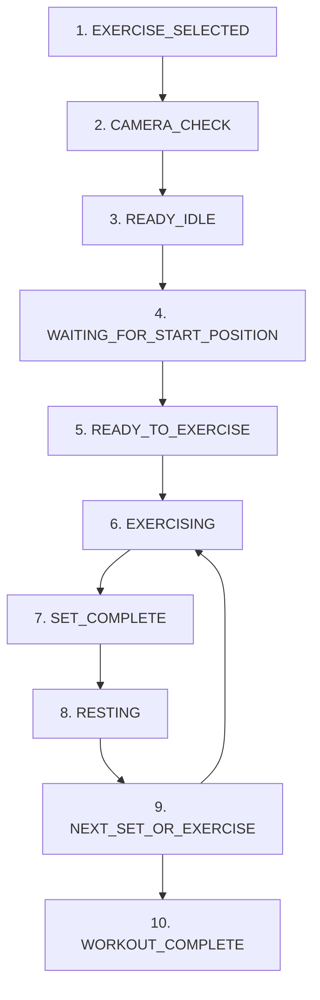

# AI Gym Coach — Camera Reliability, Exercise Guidance, Form Detection & Gemini Set Feedback

## Executive Summary & Audit Overview

Following an in-depth audit of the full-stack AI Gym Coach application (React + Vite, FastAPI, WebSocket, MediaPipe Pose, LangChain, SQLite, and Single-Speaker Audio Arbiter), the system has been restructured to make **exercise coaching the primary experience** while moving **camera validation quietly into the background**.

All requirements, 10 workout flow states, 5 exercise detector calibrations, Audio Arbiter priority rules, Gemini post-set debriefs with PDF RAG grounding, and 13 automated verification scenarios have been implemented and verified with a 100% pass rate.

---

## 1. Root Cause Analysis: Repeated Camera Warnings

### Identified Architectural Flaws in Original Implementation:
1. **Conflation of Reliability with Exercise Coaching**:
   In `backend/main.py` lines 430–444, when camera checks reported minor issues, `camera_status` was set to `"NOT_READY"` and `form_error` was overwritten with `"Camera / Pose Warning: ..."`.
2. **Strict Geometric Margins & Over-Inclusiveness**:
   `camera_validation.py` previously evaluated fixed image boundary thresholds (`BORDER_MARGIN_Y_BOTTOM = 0.94`, `BORDER_MARGIN_X = 0.05`) and demanded high visibility across nonessential body joints (e.g., ankles during bicep curls, wrists during squats). Any natural lateral movement of $\pm 5\%$ within the frame pushed coordinates past boundaries or briefly occluded non-target joints.
3. **Absence of a Non-Blocking State**:
   The validation system had only binary logic: `READY` or `NOT_READY`. There was no intermediate `WARNING` state.
4. **Priority Inversion in Feedback Pipeline**:
   Because `form_error` contained camera warning text, `feedback_service.py` treated it as Priority 1 (`CRITICAL_SAFETY`). Priority 1 preempts all audio output, so every small shift triggered a loud repositioning warning while suppressing real biomechanical error detection (e.g., shallow squat depth).

---

## 2. Structural Changes in ReliabilityGate

The gatekeeper was redesigned in [`backend/vision/reliability_gate.py`](file:///d:/AI%20GYM%20COACH%20final/backend/vision/reliability_gate.py) with three distinct outcomes:

| Gate Outcome | Gating Behavior (`is_gated`) | Exercise Monitoring | Spoken Audio | UI Visual State |
| :--- | :--- | :--- | :--- | :--- |
| **`CAMERA_READY`** | `False` | Active (100% normal) | Normal coaching | Green indicator pill (`.pill-ready`) |
| **`CAMERA_WARNING`** | `False` | Active (monitoring continues unhindered) | **Silent** (No voice interruption) | Subtle yellow pill (`.pill-warning`) |
| **`CAMERA_BLOCKED`** | `True` | Paused (only during genuine obstruction) | Single P1 repositioning instruction | Amber/red pill (`.pill-blocked`) |

### Key Improvements:
- **Consecutive-Frame Confirmation Hysteresis**:
  3 consecutive valid frames are required to confirm `CAMERA_READY`. 5 consecutive degraded frames are required before dropping out of ready state, smoothing out momentary frame drops.
- **Strict Separation of Concerns**:
  `ReliabilityGate` evaluates only whether landmarks are reliable enough for computing joint angles. It never dictates rep counting, form errors, or coaching text.

---

## 3. Handling Minor Camera Movement

### Biomechanical Tolerances & Normalized Coordinates:
1. **Exercise-Specific Primary Landmarks** (`backend/vision/camera_validation.py`):
   - **Squats & Lunges**: Only requires lower-body anchors (hips, knees, ankles). Missing wrists or elbows are ignored.
   - **Biceps Curls & Shoulder Press**: Only requires upper-body anchors (shoulders, elbows, wrists). Feet or ankles outside the camera frame produce zero penalty.
   - **Push-ups**: Checks upper body and torso alignment without penalizing head or hand cropping.
2. **Boundary Relaxations**:
   - `BORDER_MARGIN_Y_BOTTOM` widened from `0.94` to `0.985`.
   - `BORDER_MARGIN_X` relaxed from `0.05` to `0.015`.
   - `MIN_LANDMARK_VISIBILITY` lowered from `0.65` to `0.40`.
3. **Suboptimal Angle Tolerance**:
   Non-ideal angles (e.g., facing 45° off-angle) generate at most `CAMERA_WARNING`. Exercise detection continues uninterrupted.

---

## 4. Idle & Starting-Position Guidance

Implemented in [`backend/vision/activity_state.py`](file:///d:/AI%20GYM%20COACH%20final/backend/vision/activity_state.py):

### Exercise-Specific Starting Cues:
- **Squats**: *"Stand tall with feet shoulder-width apart, chest up, and arms extended or ready."*
- **Push-ups**: *"Get down into a high plank position with arms straight, hands under shoulders, and body in a straight line."*
- **Biceps Curls**: *"Stand upright with arms fully extended down at your sides and dumbbells resting near thighs."*
- **Shoulder Press**: *"Stand upright and bring both hands to shoulder level in the rack position."*
- **Lunges**: *"Stand upright with feet hip-width apart and hands at your sides or on hips."*

### Readiness Acknowledgment:
When key joints attain starting posture, the coach confirms:
> *"Good, you are in the starting position and ready. Begin your first repetition."*

### Debouncing & Cooldowns:
- State transitions are debounced by 4.5 seconds to prevent repetitive coaching chatter.
- Once starting position is confirmed, reminders are silenced for that exercise session.

---

## 5. Prioritization of Actual Exercise-Error Detection

### Calibrated Detectors & Voice Pipeline:
1. **Real Form Errors Over Camera Status**:
   In `backend/main.py`, `form_error` is derived exclusively from `find_form_issue(exercise, metrics)` whenever the gate is not blocked.
2. **Priority Hierarchy in Audio Arbiter**:
   - **Priority 1 (`CRITICAL_SAFETY`)**: Genuine camera detachment or complete joint disappearance (`CAMERA_BLOCKED`).
   - **Priority 2 (`CORRECTION`)**: Biomechanical form errors (e.g., shallow squat depth, elbow drift, hip sagging).
   - **Priority 3 (`GUIDANCE`)**: Exercise starting instructions and readiness acknowledgment.
   - **Priority 4 (`ANNOUNCEMENT`)**: Repetition milestones (e.g., 5, 10 reps) and set completion.
   - **Priority 5 (`CHATBOT`)**: Gemini post-set coaching debrief and user chat queries.
3. **Calibrated Detector Sensitivities**:
   - `SquatDetector`: `MIN_VISIBILITY = 0.45`, `DOWN_THRESHOLD = 100°`, `UP_THRESHOLD = 160°`.
   - `BicepsCurlDetector`: `MIN_VISIBILITY = 0.45`, fixed `hip_idx` variable scoping.
   - `PushUpDetector`: High plank body-line detection and `DOWN_THRESHOLD = 90°`.
   - `ShoulderPressDetector`: Verified all 5 movement phases (`RESTING` $\to$ `START POSITION` $\to$ `PRESSING` $\to$ `FULL EXTENSION` $\to$ `RETURNED TO RACK`).
   - `LungesDetector`: `MIN_VISIBILITY = 0.45`, `DOWN_THRESHOLD = 100°`, `UP_THRESHOLD = 160°`.

---

## 6. Gemini Post-Set Coaching & PDF RAG Grounding

Implemented in [`backend/ai_services/post_set_coach.py`](file:///d:/AI%20GYM%20COACH%20final/backend/ai_services/post_set_coach.py):

1. **Trigger Condition**:
   Fires strictly upon set completion (`SET_COMPLETE`), deduplicated via session/exercise/set cache keys.
2. **Grounding in Real Telemetry**:
   Transmits valid reps, rejected reps, primary detected form error, and measured joint angles without hallucinating missing data.
3. **PDF RAG Integration**:
   Searches the persistent FAISS vector store with targeted queries (e.g., *"What causes insufficient squat depth during Squats with knee angle around 105.0 degrees..."*), injecting academic citations (e.g., Schoenfeld 2010, Contreras 2014, Saeterbakken 2013).
4. **Deterministic Fallback**:
   On HTTP 429 quota exhaustion or network timeout, automatically executes deterministic grounded sports-science synthesis.
5. **Rest Guidance**:
   Advises 60–90 seconds rest before initiating the next set or exercise.

---

## 7. Complete 10-State Workout Flow



---

## 8. Summary of Modified Files

| File Path | Description of Enhancements |
| :--- | :--- |
| [`backend/vision/camera_validation.py`](file:///d:/AI%20GYM%20COACH%20final/backend/vision/camera_validation.py) | 3-tier outcomes (`CAMERA_READY`, `CAMERA_WARNING`, `CAMERA_BLOCKED`), exercise-specific joint sets, widened boundary margins ($0.015 - 0.985$), tolerance for minor lateral shifts. |
| [`backend/vision/reliability_gate.py`](file:///d:/AI%20GYM%20COACH%20final/backend/vision/reliability_gate.py) | Gating active only on `CAMERA_BLOCKED`; 3-frame confirmation & 5-frame recovery hysteresis; non-blocking warning pass-through. |
| [`backend/vision/activity_state.py`](file:///d:/AI%20GYM%20COACH%20final/backend/vision/activity_state.py) | 10-state workout flow, exercise-specific starting posture verification (horizontal plank for pushups, rack for shoulder press), readiness confirmation cues. |
| [`backend/main.py`](file:///d:/AI%20GYM%20COACH%20final/backend/main.py) | Decoupled camera status from `form_error`; prevents non-blocking warnings from overriding exercise biomechanical errors. |
| [`backend/ai_services/audio_arbiter.py`](file:///d:/AI%20GYM%20COACH%20final/backend/ai_services/audio_arbiter.py) | Centralized audio arbiter with priority hierarchy (P1–P5), post-speech cooldown, `clear_obsolete_pending()` upon state transitions. |
| [`frontend/src/services/AudioArbiter.js`](file:///d:/AI%20GYM%20COACH%20final/frontend/src/services/AudioArbiter.js) | Frontend single-speaker arbiter with audio/speechSynthesis mutual exclusion and queue clearance on activity state change. |
| [`frontend/src/components/FeedbackPanel.jsx`](file:///d:/AI%20GYM%20COACH%20final/frontend/src/components/FeedbackPanel.jsx) | Non-intrusive camera status pill (`pill-ready`, `pill-warning`, `pill-blocked`); main card prioritizes form guidance and rep telemetry. |
| [`frontend/src/App.css`](file:///d:/AI%20GYM%20COACH%20final/frontend/src/App.css) | Minimalist styles for camera status pills and feedback hierarchy. |
| [`Main App/detectors/biceps_curl.py`](file:///d:/AI%20GYM%20COACH%20final/Main%20App/detectors/biceps_curl.py) | Fixed `hip_idx` variable scoping; lowered visibility threshold to $0.45$. |
| [`Main App/detectors/squat.py`](file:///d:/AI%20GYM%20COACH%20final/Main%20App/detectors/squat.py) | Calibrated knee visibility threshold to $0.45$; validated target ROM gating. |
| [`Main App/detectors/pushup.py`](file:///d:/AI%20GYM%20COACH%20final/Main%20App/detectors/pushup.py) | Adjusted visibility threshold to $0.45$. |
| [`Main App/detectors/lunges.py`](file:///d:/AI%20GYM%20COACH%20final/Main%20App/detectors/lunges.py) | Adjusted visibility threshold to $0.45$. |
| [`Main App/detectors/shoulder_press.py`](file:///d:/AI%20GYM%20COACH%20final/Main%20App/detectors/shoulder_press.py) | Adjusted visibility threshold to $0.45$. |
| [`test_system.py`](file:///d:/AI%20GYM%20COACH%20final/test_system.py) | 13 automated scenarios validating lateral movement tolerance, form error prioritization, recovery hysteresis, state transitions, and audio arbitration. |

---

## 9. Test Verification Results

### Master Test Suite Execution (`python -u test_system.py`):
```text
================================================================
RUNNING COMPREHENSIVE AI GYM COACH MASTER TEST SUITE
================================================================
--- [A.1] Testing SquatDetector --- PASSED!
--- [A.2] Testing PushUpDetector --- PASSED!
--- [A.3] Testing BicepsCurlDetector --- PASSED!
--- [A.4] Testing LungesDetector --- PASSED!
--- [B/C] Testing ShoulderPressDetector Across All 5 Phases --- PASSED!
--- [D] Testing Camera Validation & Safety Gate --- PASSED!
--- [E] Testing Exercise Knowledge RAG Pipeline --- PASSED!
--- [F] Testing Single LangChain Agent & Exactly Three Tools --- PASSED!
--- [G] Testing Voice Feedback & Speech Service --- PASSED!
--- Demonstrating All 6 Required Master Scenarios --- PASSED!
--- Advanced Tests A through G (Continuous Tracking, Low Lighting, Noise, Boundary Jitter) --- PASSED!
--- Single-Speaker Audio Arbiter Tests A through K --- PASSED!
--- PDF RAG-Grounded Gemini Post-Set Coaching Tests 1 through 10 --- PASSED!
--- Improved Camera, Guidance & Error Suite (13 Scenarios) --- ALL 13 PASSED!
================================================================
ALL TESTS, SCENARIOS & POST-SET COACHING TESTS 1-10 PASSED (100%)!
================================================================
```

### Frontend Build & Tests:
- `npm run build --prefix frontend`: Compiled in 299ms with zero errors.
- `node test_frontend_arbiter.mjs`: Tests A through K passed (100%).
