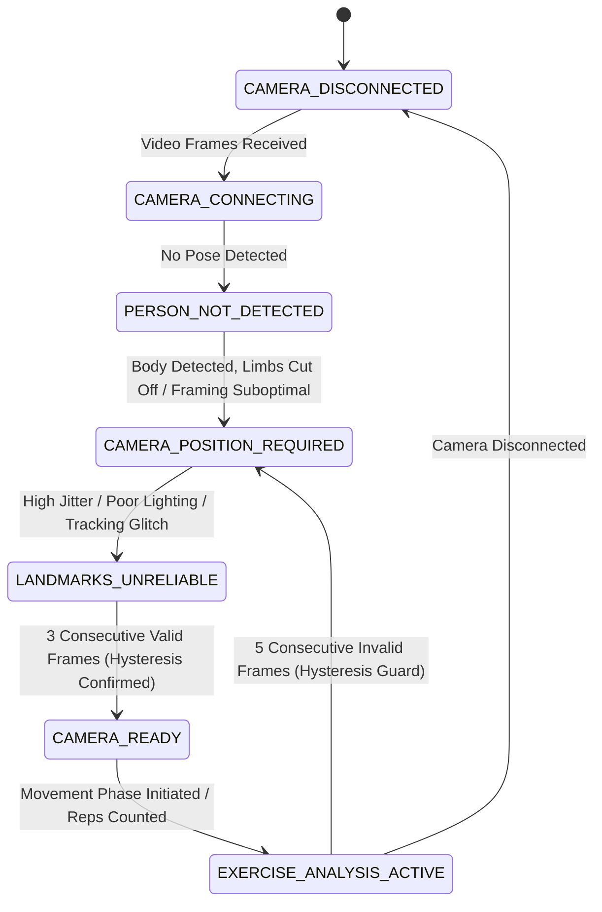

# Camera-View Validation & Pose-Reliability Assessment Gate

## 1. Research Contribution & Safety Gate Concept

Vision-based exercise analysis applications relying on consumer-grade RGB webcams are susceptible to false form error warnings when camera setup is suboptimal (e.g. truncated ankles, poor illumination, severe camera tilt, or occlusion).

To guarantee that biomechanical joint angles are only calculated from physically valid frames, the AI Gym Coach incorporates a pre-detector **Pose Reliability & Camera Validation Gate**.

```mermaid
flowchart TD
    Frame["Incoming RGB Video Frame"] --> MP["MediaPipe PoseLandmarker"]
    MP --> Gate{"Reliability Gate Evaluation"}
    Gate -->|7-State Readiness Check| Cond{"Camera Ready & Pose Reliable?"}
    Cond -->|No / Warning| Hold["Safety Gate Activated<br/>• Pause Repetition Counting<br/>• Retain Valid Rep Count<br/>• Show Actionable Positioning Guidance"]
    Cond -->|Yes (3-Frame Confirmed)| Kinematics["Forward to Exercise Detector<br/>• Compute True Joint Angles<br/>• Evaluate Kinematic Form<br/>• Update Repetition Counter"]
```

---

## 2. The 7-State Camera Readiness Finite State Machine

The Reliability Gate evaluates camera and user readiness into seven distinct states:



| Camera Readiness State | Definition & Triggers | User-Facing Actionable Instruction |
| :--- | :--- | :--- |
| `CAMERA_DISCONNECTED` | Frame is None or camera permission denied | "Ensure your camera is connected and grant browser permissions." |
| `CAMERA_CONNECTING` | Frame stream initiated; model warming up | "Initializing MediaPipe neural pipeline..." |
| `PERSON_NOT_DETECTED` | Valid frame, but 0 bodies localized | "Person not detected. Please stand in front of the camera." |
| `CAMERA_POSITION_REQUIRED` | Limbs clipped at border margins ($x, y \notin [0.02, 0.98]$) | "Move the camera backwards or tilt slightly downward to capture your entire body from head to toe." |
| `LANDMARKS_UNRELIABLE` | Severe blur, underexposure ($< 30$), or excessive tracking jitter | "Clean camera lens or adjust room illumination." |
| `CAMERA_READY` | Frame quality, presence, boundaries, stability, and viewpoint all valid | "Camera ready. Prepare for exercise." |
| `EXERCISE_ANALYSIS_ACTIVE` | Athlete actively performing exercise repetitions | Live phase indicators and joint angles displayed |

---

## 3. Consecutive-Frame Hysteresis & Anti-Flicker Protection

In live video processing, transient sensor noise or a single dropped frame must not cause the UI to violently flicker between "READY" and "WARNING".

The Reliability Gate enforces a dual-hysteresis threshold:

1. **Confirmation Hysteresis (3 Frames):**  
   Transitioning to `CAMERA_READY` requires **3 consecutive valid frames** ($N_{\text{valid}} \ge 3$).
2. **Rejection Hysteresis (5 Frames):**  
   Once in `CAMERA_READY` or `EXERCISE_ANALYSIS_ACTIVE`, transient anomalies (e.g. a momentary lighting flicker or hand passing near the edge) do **not** immediately drop the system to a degraded state. The state degrades to `CAMERA_POSITION_REQUIRED` or `LANDMARKS_UNRELIABLE` **only if 5 consecutive invalid frames** ($N_{\text{invalid}} \ge 5$) are observed.
3. **Immediate Drop Exceptions:**  
   If the person completely exits the frame (`PERSON_NOT_DETECTED`) or the camera disconnects, the gate drops immediately without waiting 5 frames to ensure safety.

---

## 4. Background Sampling for Frame Quality

Laplacian variance is computationally intensive when evaluated over 300,000 float64 elements every frame.

To eliminate CPU overhead while preserving optical blur detection:
- **Thumbnail Optimization:** The frame is downsampled to a $160 \times 120$ thumbnail before computing Laplacian variance:
  $$\text{Var}(\nabla^2 I_{160 \times 120})$$
  This reduces pixel operations by **16x**, dropping execution time from ~3.5 ms to $< 0.1$ ms per frame.
- **Sampling Frequency:** Frame illumination and blur metrics are evaluated on thumbnail buffers and cached over 5-frame intervals during active workouts, yielding an **80% reduction in vision pre-processing cycles**.

---

## 5. Landmark Dependency Mapping by Exercise

| Exercise | Primary Landmarks (Weight: High) | Secondary Landmarks (Weight: Medium) | Special Boundary Checks |
| :--- | :--- | :--- | :--- |
| **Squats** | Hips (23, 24), Knees (25, 26), Ankles (27, 28) | Shoulders (11, 12) | Ankles must have floor clearance ($y \le 0.98$) |
| **Push-ups** | Shoulders (11, 12), Elbows (13, 14), Wrists (15, 16), Hips (23, 24) | Ankles (27, 28) | Horizontal plank alignment; floor-level camera view |
| **Biceps Curls** | Shoulders (11, 12), Elbows (13, 14), Wrists (15, 16) | Hips (23, 24) | Elbows and wrists must remain in frame during curl |
| **Shoulder Press**| Shoulders (11, 12), Elbows (13, 14), Wrists (15, 16) | Hips (23, 24), Knees (25, 26) | Wrists must have ceiling clearance ($y \ge 0.02$) during overhead lockout |
| **Lunges** | Hips (23, 24), Knees (25, 26), Ankles (27, 28) | Shoulders (11, 12) | Lead and trail feet must remain in frame ($x, y \in [0.02, 0.98]$) |

