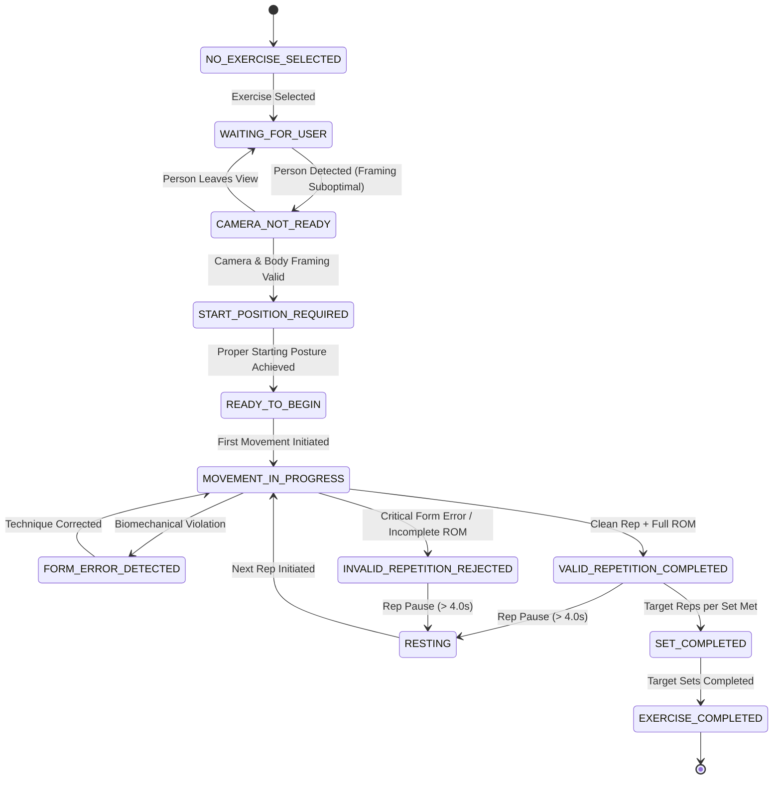
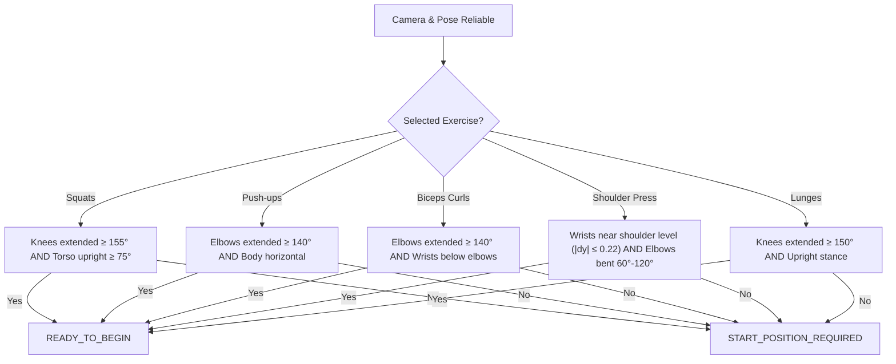
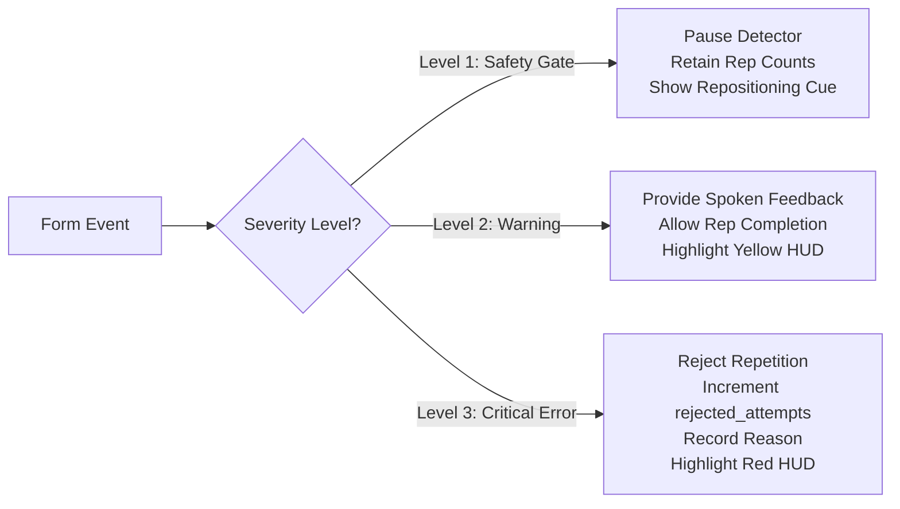

# AI Gym Coach — Exercise State Machines & Coaching Activity Specification

## 1. System Overview & Architectural Separation

The AI Gym Coach implements a hierarchical two-tier state machine architecture to decouple high-level user coaching interactions from low-level kinematic repetition tracking:

1. **Tier 1: Global Coaching Activity State Machine (13 States)**  
   Governs user workflow, camera presence, starting position verification, idle coaching prompts, recovery intervals, and session completion.
2. **Tier 2: Exercise Kinematic State Machines (Per-Exercise)**  
   Governs joint-angle tracking, movement phase transitions, range of motion (ROM) verification, inflection points, and form error validation.

---

## 2. Tier 1: The 13 Coaching Activity States

| State | Trigger / Condition | Contextual Voice & HUD Guidance | Idle Behavior |
| :--- | :--- | :--- | :--- |
| `NO_EXERCISE_SELECTED` | User active, but no workout routine selected | "Please select an exercise to begin your workout." | Idle prompt dispatched immediately |
| `CAMERA_NOT_READY` | Frame dark, blurry, or required landmarks cut off | "Your full body is not visible. Move the camera backwards or adjust its position." | Safety gate pauses kinematic detectors |
| `WAITING_FOR_USER` | Camera connected, but zero bodies detected | "Person not detected. Please stand in front of the camera." | Prompts after 1.0s presence timeout |
| `START_POSITION_REQUIRED` | Body visible, but user has not assumed start posture | Exercise-specific posture cue (e.g. "Bring dumbbells to shoulder level in the rack position.") | Dispatched after 2.0s posture check |
| `READY_TO_BEGIN` | Proper starting posture confirmed | "Your camera is ready. Stand in the correct starting position and begin your first repetition when ready." | Dispatched after 4.5s idle threshold |
| `EXERCISE_STARTED` | User begins movement from confirmed start posture | Visual phase indicator lights up (e.g. "LOWERING") | Live tracking engaged |
| `MOVEMENT_IN_PROGRESS` | Traversal through active exercise phases | Phase-specific HUD telemetry and angle indicators | Suppresses idle timeouts |
| `FORM_ERROR_DETECTED` | Critical or warning form deviation detected | Immediate targeted corrective cue (e.g. "Keep your chest lifted and torso upright.") | Audio synthesized with 3.5s cooldown |
| `VALID_REPETITION_COMPLETED` | Successful rep completion meeting all ROM & form criteria | "Repetition {N} completed with great form!" | Increments `valid_reps`, updates counter |
| `INVALID_REPETITION_REJECTED` | Rep attempt completed with form failure or shallow ROM | "Repetition rejected. Ensure full range of motion without form collapse." | Increments `rejected_attempts`, logs reason |
| `RESTING` | Pause between repetitions (> 4.0s without movement) | "Resting between repetitions ({N}s elapsed)." / "Good rest interval. Catch your breath." | Prompts at 15s (rest) and 30s (inactivity) |
| `SET_COMPLETED` | Valid reps reach `reps_per_set` target | "Set completed! Rest and prepare for the next set." | Enters inter-set recovery timer |
| `EXERCISE_COMPLETED` | All sets (`target_sets`) successfully completed | "Workout target completed! Outstanding effort!" | Prompts session save to SQLite |

---

## 3. Starting Posture Detection Criteria

Before the first repetition is counted, the system evaluates the athlete's resting posture against biomechanical starting rules:

---

## 4. Tier 2: Per-Exercise Kinematic State Machines

### 4.1 Squats (`SquatDetector`)
- **Primary Landmarks:** Hips (23, 24), Knees (25, 26), Ankles (27, 28), Shoulders (11, 12).
- **Phases:**
  1. `READY` / `STANDING`: Knee angle $> 160^\circ$, back angle $> 75^\circ$.
  2. `DESCENT` / `LOWERING`: Knee angle drops $< 140^\circ$. Movement direction confirmed downward.
  3. `BOTTOM`: Knee angle reaches minimum ($\le 95^\circ$ for valid parallel depth).
  4. `ASCENT` / `RISING`: Knee angle increases from bottom ($> 100^\circ$).
  5. `COMPLETED`: Knee angle returns to $\ge 155^\circ$.
- **Form Error Evaluation Order:**
  - Forward Torso Lean: Evaluated during descent/bottom (`back_angle < 75.0`).
  - Knee Valgus: Evaluated at bottom (`knee_distance < ankle_distance * 0.70`).
  - Shallow Depth: Evaluated upon return to standing without reaching $\le 95^\circ$.

### 4.2 Push-ups (`PushUpDetector`)
- **Primary Landmarks:** Shoulders (11, 12), Elbows (13, 14), Wrists (15, 16), Hips (23, 24), Ankles (27, 28).
- **Phases:**
  1. `PLANK`: Elbow angle $> 150^\circ$, body deviation $< 0.08$.
  2. `DESCENT`: Elbow angle decreases $< 140^\circ$.
  3. `BOTTOM`: Elbow angle reaches depth ($\le 90^\circ$).
  4. `ASCENT`: Elbow angle increases past $110^\circ$.
  5. `COMPLETED`: Elbow angle returns to $\ge 150^\circ$.
- **Form Errors:**
  - Hip Sagging: Pelvis dips below shoulder-ankle line (`hip_deviation > +0.08`).
  - Piked Hips: Pelvis rises above shoulder-ankle line (`hip_deviation < -0.08`).
  - Incomplete Depth: Fails to reach $\le 90^\circ$ elbow flexion.

### 4.3 Biceps Curls (`BicepsCurlDetector`)
- **Primary Landmarks:** Shoulders (11, 12), Elbows (13, 14), Wrists (15, 16), Hips (23, 24).
- **Phases:**
  1. `DOWN`: Arms extended, elbow angle $> 150^\circ$.
  2. `CURLING`: Elbow angle decreases $< 135^\circ$.
  3. `FLEXED`: Elbow angle reaches peak contraction ($\le 60^\circ$).
  4. `LOWERING`: Elbow angle increases past $75^\circ$.
  5. `COMPLETED`: Full extension restored ($> 150^\circ$).
- **Form Errors:**
  - Torso Swinging: Back angle deviates $> 15^\circ$ from vertical.
  - Elbow Drift: Elbow moves forward $> 0.06$ normalized units relative to shoulder.
  - Incomplete ROM: Curl peak does not achieve $\le 60^\circ$ or extension fails to reach $150^\circ$.

### 4.4 Shoulder Press (`ShoulderPressDetector`)
- **Primary Landmarks:** Shoulders (11, 12), Elbows (13, 14), Wrists (15, 16), Hips (23, 24), Knees (25, 26).
- **Phases:**
  1. `RESTING`: Arms down at sides ($y_{\text{wrist}} > y_{\text{shoulder}} + 0.08$). Stage: `ready`.
  2. `RACK POSITION`: Dumbbells at shoulders, elbows bent $60^\circ - 110^\circ$. Stage: `down`.
  3. `PRESSING`: Arms extending upward, elbow angle $100^\circ - 145^\circ$. Stage: `up`.
  4. `OVERHEAD LOCKOUT`: Arms fully extended overhead ($\ge 155^\circ$), wrists above shoulders. Stage: `up`.
  5. `COMPLETED`: Controlled return to rack position ($\le 115^\circ$). Rep counted! Stage: `down`.
- **Form Errors:**
  - Excessive Lumbar Arching: Back angle $< 140^\circ$ during upward press.
  - Flaring Elbows Outward: Extreme coronal elbow abduction.
  - Incomplete Overhead Lockout: Fails to reach $\ge 155^\circ$ extension.

### 4.5 Lunges (`LungesDetector`)
- **Primary Landmarks:** Hips (23, 24), Knees (25, 26), Ankles (27, 28), Shoulders (11, 12).
- **Phases:**
  1. `STANDING`: Both knee angles $> 155^\circ$.
  2. `STEPPING / DESCENT`: Lead knee flexes $< 140^\circ$.
  3. `LUNGE BOTTOM`: Lead knee reaches target depth ($80^\circ - 100^\circ$).
  4. `ASCENT`: Pushing off lead heel, knee angle increases $> 120^\circ$.
  5. `COMPLETED`: Return to standing posture ($> 155^\circ$).
- **Form Errors:**
  - Lateral Loss of Balance: Stance width falls into tightrope posture.
  - Shallow Depth: Lead knee does not achieve $\le 100^\circ$.
  - Torso Collapse: Torso angle $< 70^\circ$.

---

## 5. Form Error Severity Policy & Action Matrix

| Error Severity | Definition & Examples | Repetition Action | Voice Feedback Action |
| :--- | :--- | :--- | :--- |
| **Level 1: Safety Gate** | Camera dark, blurry, occluded, or body out of frame | Analysis paused; current valid rep count preserved | Immediate positioning instruction dispatched |
| **Level 2: Technique Warning** | Slight head misalignment, minor tempo variation, border margin proximity | Repetition allowed to complete; form scored | Contextual reminder delivered if error persists |
| **Level 3: Critical Error** | Knee valgus collapse, extreme lumbar hyperextension, torso swing momentum, hip sagging | Repetition rejected; recorded as rejected attempt | Corrective verbal cue delivered immediately with 3.5s cooldown |

